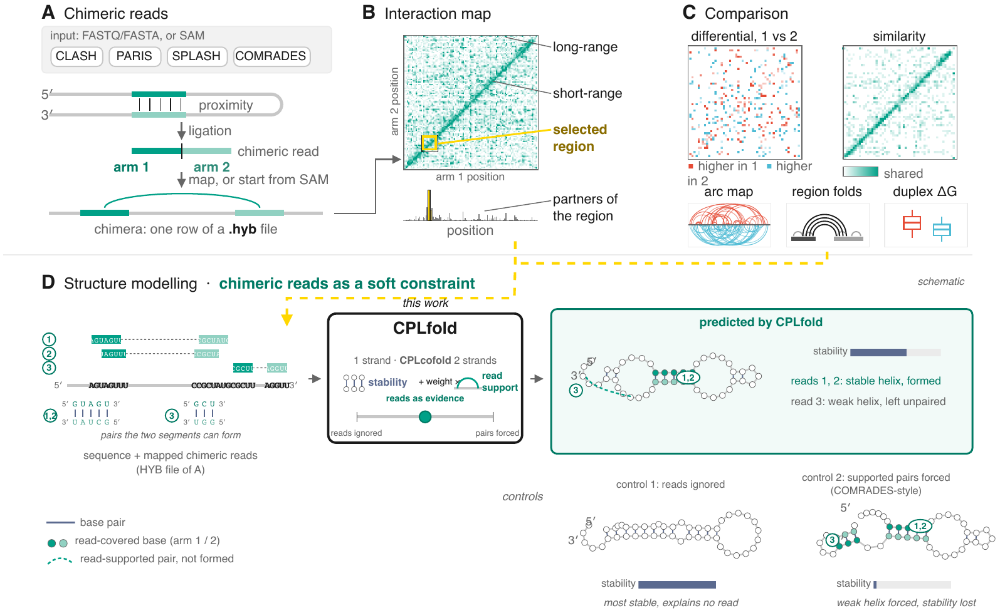
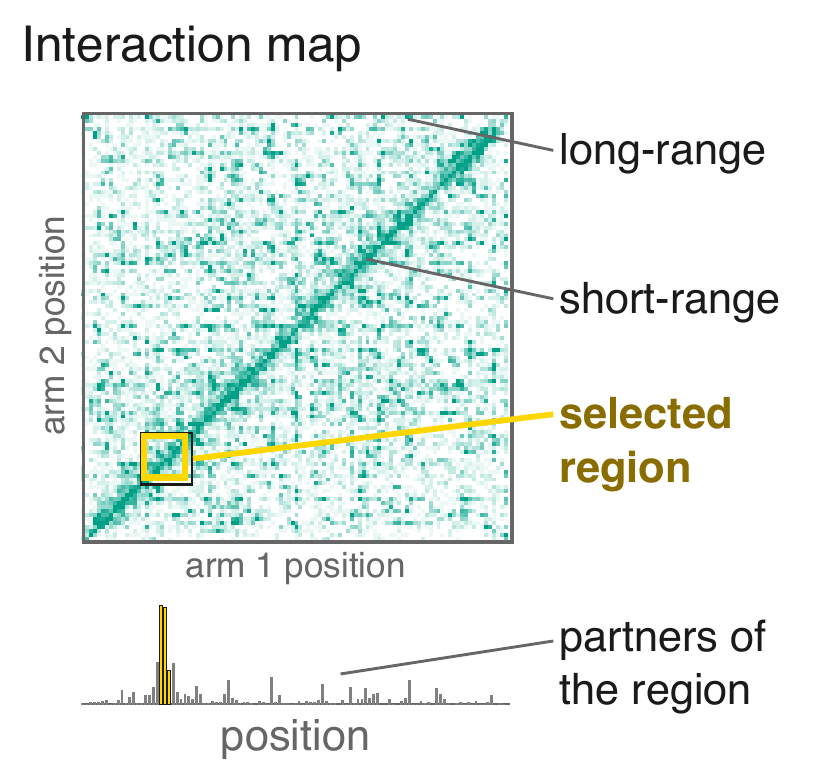

# Hyb2

Hyb2 analyses RNA proximity ligation experiments, such as CLASH, PARIS, SPLASH and COMRADES, which ligate two base-paired RNA segments into one chimeric read. Minimum free energy folding often misses the long-range base pairs that these reads reveal, and the data have lacked integrated analysis tools. From reads or a mapped SAM file, Hyb2:

1. lists the chimeric RNA–RNA interactions, with their coordinates, sequences and folding energies, in a `.hyb` file;
2. plots them as contact density maps and viewpoint graphs, and compares experiments;
3. folds the RNA structures that the chimeras support: short- and long-range interactions within one RNA, interactions between RNAs, and homodimers.

<p align="center">
  
</p>

## Contents
- [Choose an entry point](#choose-an-entry-point)
- [Quickstart](#quickstart)
- [Input files](#input-files)
- [`hyb2pipe` options](#hyb2pipe-options)
- [The original `bin/` tools](#the-original-bin-tools)
- [CPLfold and IRIS](#cplfold-and-iris)
- [How to read the outputs](#how-to-read-the-outputs)
- [License](#license)

## Choose an entry point

| Entry point | Use it for | Input | Install |
|---|---|---|---|
| [Web app](https://vicky-0256.github.io/hyb2/) | Exploring `.hyb` files, comparisons and CPLfold/IRIS structures in the browser; files stay on your computer | `.hyb` | None. To serve your own copy, build it with `make build-web` and serve `web/` ([web/README.md](web/README.md)) |
| Desktop app | One project from raw reads to structures, offline | FASTQ, FASTA, SAM or `.hyb` | Installers for macOS (Apple silicon), Windows and Linux on the [Releases](https://github.com/Vicky-0256/hyb2/releases) page. To build it, see [desktop/README.md](desktop/README.md) |
| `hyb2pipe` (command line) | Reads to `.hyb` on any OS, in scripts or on a cluster. This is the CLI described in the paper | FASTQ, FASTA or SAM, optionally gzipped | Python 3.9+ ([Quickstart](#quickstart)); Bowtie2 for FASTQ/FASTA |
| Original `bin/` tools | Contact density maps, viewpoint graphs, VARNA drawings, the R Shiny GUI and DESeq2 comparisons | `.hyb` (or reads, through the legacy `hyb2`) | conda, Perl, R and Java ([below](#the-original-bin-tools)) |

The desktop app runs `hyb2pipe` for each sample. On the command line, `hyb2pipe` makes the `.hyb` and the other commands read it:

| Step | Command | Location |
|---|---|---|
| FASTQ/FASTA/SAM to `.hyb` | `python3 -m hyb2pipe` (legacy: `hyb2 -i reads.sam ...`) | `pipeline/hyb2pipe/` (legacy: `bin/`) |
| Contact density maps, viewpoint graphs | `hyb2 -i test.hyb -a GENE` | `bin/` (R) |
| Structure folding and VARNA drawings | `hyb2_fold`, `hyb2 ... -x -y -l` | `bin/` |
| Interactive GUI | `hyb2_app` | `bin/` (R Shiny) |
| Differential coverage and similarity | `hyb2_compare` | `bin/` (R, DESeq2) |
| CPLfold and CPLcofold | `bin/cplfold`, `bin/cplcofold` | `third_party/cplfold/` |
| IRIS | `bin/iris` | `pipeline/hyb2analysis/iris.py` |

## Quickstart
This turns the bundled Zika and 18S rRNA test data into `.hyb` files with `hyb2pipe`. It needs Python 3.9 or newer, Git and `make`, but no conda, Perl or R:

```bash
git clone https://github.com/Vicky-0256/hyb2.git
cd hyb2
python3 -m venv .venv && . .venv/bin/activate
python -m pip install -r pipeline/requirements.txt
make quickstart
```

`make quickstart` runs `PYTHONPATH=pipeline python3 -m hyb2pipe -i data/testData.sam -d data/Zika_18S.fasta -o out/quickstart -e 1`. It writes 10,411 hybrids, with their folding energies (dG), to `out/quickstart.hyb`, plus `out/quickstart_homodimers.hyb` and `out/quickstart_hybrids.hyb_stats.txt`. Without `make` (for example in a Windows command prompt, where the venv is activated with `.venv\Scripts\activate`), run that command directly, with `set PYTHONPATH=pipeline` in place of the `PYTHONPATH=pipeline` prefix. `make help` lists the test and build targets.

Then open the `.hyb` files in the web or desktop app, or plot and fold them with the [`bin/` tools](#the-original-bin-tools).

## Input files
**Reads: FASTQ or FASTA, optionally gzipped.** Hyb2 trims the 3′ adapter with cutadapt, collapses identical reads into one read named `<rank>_<count>` (later steps take the read count from that name) and maps them with Bowtie2 `-L 10 --score-min L,15,0`, the mapping defaults of the Kudla lab's U2 benchmark (Brr2 CLASH data). FASTA reads that all have such names already are mapped as they are, without trimming. Bowtie2 is not a Python package: install it with conda (bioconda `bowtie2`) or put `bowtie2-align-s` and `bowtie2-build-s` on the `PATH`.

**SAM from another aligner, optionally gzipped.** Read names must end in `_<count>` and must not start with `@`, and reads must be single-end:
- Records with flag 0, 16, 256 or 272 (primary and secondary alignments) are used.
- A paired-end record (flag bit 0x1) stops the run with an error.
- Unmapped records (0x4) are skipped and counted.
- Supplementary alignments (0x800) are skipped with a warning, so have the mapper report chimeric arms as secondary alignments (for example `bwa mem -M`).
- Records with any other flag, such as QC-fail (0x200) or duplicate (0x400), are skipped with a warning and counted separately.

**Reference FASTA (`-d`).** Headers without `|` are used as they are. If any header contains `|`, Hyb2 rewrites every header (`_` becomes `-`, `protein_coding` becomes `mRNA`, and `|` becomes `_`) and drops the records whose header has an empty field (`||`), `unknown` or `pseudogene`. So `>Zika|virusRNA` in `data/Zika_18S.fasta` becomes `Zika_virusRNA`, the gene ID used with `-a` below. An informative ID joins the gene ID, transcript ID, gene name and gene type, for example `>ENSG00000007372.25_ENST00000638963.1_PAX6_mRNA` (see [`data/Zika_18S_formatted.fasta`](data/Zika_18S_formatted.fasta)).

## `hyb2pipe` options
```bash
PYTHONPATH=pipeline python3 -m hyb2pipe \
    -i <input> -d <reference.fasta> -o <output_prefix> [options]
```

| Option | Meaning | Default |
|---|---|---|
| `-i` | FASTQ, FASTA or SAM, each optionally gzipped | required |
| `-d` | Reference FASTA used for mapping | required |
| `-o` | Output prefix | required |
| `-v` | BLAST threshold | 0.1 |
| `-m` | Maximum overlap | 4 |
| `-h` | Maximum hits per sequence | 10 |
| `-e` | `1` adds the dG column; needs the ViennaRNA Python package, which `pipeline/requirements.txt` installs, or `RNAduplex` on the `PATH` | 0 (off) |
| `--energy-engine` | dG engine with `-e 1`; `rnacofold` gives the legacy `hyb2` values | `rnaduplex` |
| `-p` | Bowtie2 threads and worker processes | all CPUs |
| `--adapter` | 3′ adapter trimmed with cutadapt; `none` skips trimming | `TGGAATTCTCGGGTGCCAAGG` |
| `--min-length` | Minimum read length after trimming | 18 |
| `--seed-length`, `--score-min` | Bowtie2 `-L` and `--score-min` (legacy `hyb2`: 16 and `L,18,0`) | 10 and `L,15,0` |
| `--bowtie2-args` | Further Bowtie2 arguments, quoted | none |
| `--keep-sam` | Also write `<output_prefix>.sam` (`plain`) or `.sam.gz` (`gz`) | `none` |
| `--memory-mb`, `--tmp-dir`, `--no-resume` | Memory budget, work directory and resuming | 1024 and `<output_prefix>.work` |

It writes `<output_prefix>.hyb`, `<output_prefix>_homodimers.hyb` and `<output_prefix>_hybrids.hyb_stats.txt`. [`pipeline/README.md`](pipeline/README.md) documents every option, memory use and resuming.

## The original `bin/` tools
The shell, Perl, awk and R scripts in `bin/` plot and fold `.hyb` files; `hyb2pipe` replaces their first step (`sam_filt`, `sam2hyb` and the `bowtie2_*` wrappers). They run on Linux and macOS, and on Windows with WSL ([guide](docs/install-wsl.md)).

### Install
Install Miniconda ([Linux](https://docs.conda.io/projects/conda/en/latest/user-guide/install/linux.html), [macOS](https://docs.conda.io/projects/conda/en/latest/user-guide/install/macos.html)) and [Java](https://www.oracle.com/java/technologies/downloads), then:

```bash
git clone https://github.com/Vicky-0256/hyb2.git
cd hyb2
bin/hyb2_install              # Linux
bin/hyb2_install_macOS        # macOS (Intel)
bin/hyb2_install_macOS-arm    # macOS (Apple silicon)
```

The script creates the conda environments and adds `bin/` to your `PATH`. Open a new terminal, and activate the environment in each new terminal:

```bash
conda activate hyb2              # Linux
conda activate hyb2_macOS        # macOS (Intel)
conda activate hyb2_macOS-arm    # macOS (Apple silicon)
```

VARNA is in `third_party/varna/` (it was `VARNA/` before November 2026). If you installed an earlier version, point `bin/VARNA.dir` at the new jar after updating:
```bash
printf '%s\n' "$PWD/third_party/varna/build/jar/VARNAcmd.jar" > bin/VARNA.dir
```

### Plot and fold the test data
Run these from the folder that contains your `hyb2` clone. First make `test.hyb`, once:

```bash
PYTHONPATH=hyb2/pipeline python3 -m hyb2pipe \
    -i hyb2/data/testData.sam -d hyb2/data/Zika_18S.fasta -o test -e 1
```

Each `hyb2` command below plots the contact density maps and the viewpoint graph of a region, and folds its structure:

```bash
# Short-range, within one RNA: ZIKV 1001-1500
hyb2 -i test.hyb -d hyb2/data/Zika_18S.fasta -a Zika_virusRNA -x 1001 -l 500
# Long-range, within one RNA: ZIKV 1001-1500 with 5001-5500
hyb2 -i test.hyb -d hyb2/data/Zika_18S.fasta -a Zika_virusRNA -x 1001 -y 5001 -l 500
# Between two RNAs: ZIKV 7501-8000 with 18S rRNA 501-1000
hyb2 -i test.hyb -d hyb2/data/Zika_18S.fasta -a Zika_virusRNA -b 18S_rRNA -x 7501 -y 501 -l 500
# Homodimer: ZIKV 3501-3700 with 3501-3700 of a second ZIKV strand
hyb2 -i test.hyb -d hyb2/data/Zika_18S.fasta -a Zika_virusRNA -b Zika_virusRNA \
    -x 3501 -y 3501 -l 200
```

The first run also writes `hyb2/data/Zika_18S.hyb.fasta`, the reference with the rewritten IDs used in the `.hyb` ([Input files](#input-files)), which `hyb2_app` and `hyb2_compare` read below.

### `hyb2` options
| Option | Meaning | Default |
|---|---|---|
| `-i` | The `.hyb` file, or reads ([below](#making-the-hyb-with-the-legacy-hyb2)) | |
| `-d` | Reference FASTA | |
| `-2` | Reference FASTA of the `-b` gene, if it is in another file | the `-d` file |
| `-a` | Gene ID of interest | |
| `-b` | Second gene ID, for interactions between two RNAs or homodimers | |
| `-x` | Start of the first region, in the `-a` gene | |
| `-y` | Start of the second region, in the `-b` gene if given | |
| `-l` | Length of each region | |
| `-q` | Upper limit of the colour scale of the contact density maps, as a quantile of the chimera counts | 0.95 |
| `-j` | Path to `VARNAcmd.jar` | set by the install |
| `-r` | Folding program: `1` ViennaRNA, `0` UNAFold (not distributed with Hyb2), `2` mfold 3.6 | 1 |

### Folding constraints and programs
The folding constraints are the helices that the chimeras support: each chimera's two arms are folded with RNAcofold, and the base pairs between the arms are counted. A pair is counted once, whichever arm was sequenced first; touching pairs are merged into helices; pairs with less than 5% of a helix's best pair's count are trimmed from the helix's ends; and each constraint is written once. This follows the `gk-dev` branch of hyb2; before, a pair seen in both arm orders had its count split in two and could give the same constraint twice.

- **mfold (`-r 2`)** folds with mfold 3.6 (`conda install -c bioconda mfold`), which applies the constraints as forced base pairs; `bin/mfold_check` tests this before folding. mfold has no duplex folding, so in this mode the chimeras' base-pair scores use ViennaRNA's RNAcofold, as in `-r 1`; so does the `.hyb` dG column when the legacy `hyb2` builds the `.hyb` itself. A `.hyb` from `hyb2pipe` already holds its dG (`--energy-engine`), which `-r` does not change. `bin/mfold_fold` runs each fold in a temporary folder with links to mfold's energy tables (the bioconda build finds them only in the current folder); `MFOLD` names another mfold script.
- **UNAFold (`-r 0`)** needs the full UNAFold `hybrid-ss-min`, which applies the constraints as forced base pairs. The `hybrid-ss-min` of OligoArrayAux (the conda `oligoarrayaux` package, installed for `hybrid-min`) silently ignores forced pairs, so `-r 0` stops with an error when it is the one found (`bin/unafold_check` tests this before folding). Put the full UNAFold's `hybrid-ss-min` first on `PATH`, set `HYBRID_SS_MIN` to it, or use ViennaRNA (`-r 1`).

### Other commands
Contact density maps only, without a viewpoint graph or structure, of a whole RNA or zoomed in:
```bash
hyb2 -i test.hyb -a 18S_rRNA                          # or: hyb2_coverage -i test.hyb -a 18S_rRNA
hyb2 -i test.hyb -a 18S_rRNA -x 201 -y 201 -l 1200
hyb2_coverage -i test.hyb -a 18S_rRNA -w 201 -x 1400 -y 201 -z 1400   # -w -x -y -z: x1 x2 y1 y2
```

A structure straight from a `.hyb`:
```bash
hyb2_fold -i test.hyb -d hyb2/data/Zika_18S.fasta -a Zika_virusRNA -x 1 -y 1001 -l 200
```

**Randomized parallel folding.** `comradesFold2` folds the RNA 1,000 times and `comradesScore` scores each structure. It needs a computer cluster that runs `qsub`. For the interactions between ZIKV and 18S rRNA above:
```bash
qsub comradesFold2 \
    -c test_Zika_virusRNA-7501-8000_18S_rRNA-501-1000.1-1100_folding_constraints.txt \
    -i Zika_virusRNA-7501-8000_18S_rRNA-501-1000_1-1100.fasta -s 1

comradesScore -i test_Zika_virusRNA-7501-8000_18S_rRNA-501-1000.basepair_scores.txt \
    -f Zika_virusRNA-7501-8000_18S_rRNA-501-1000_1-1100.fasta
```

**Interactive GUI** ([what it shows](#hyb2-gui)):
```bash
hyb2_app -i test.hyb -a Zika_virusRNA -d hyb2/data/Zika_18S.hyb.fasta
```

**Comparing experiments.** `hyb2_compare` finds the interactions that differ between two conditions with DESeq2 and plots a differential coverage map, and plots the interactions that they share as a similarity heatmap. Each condition needs at least two replicates. List each replicate's `.hyb`, its `.contact.txt` (written with the contact density maps) and its condition in a tab-separated table made by hand, as in [`data/hyb2_compare_input.table`](data/hyb2_compare_input.table). `hyb2_compare` does not run on macOS on Apple silicon (ARM), where several DESeq2 packages are not supported.
```bash
hyb2_compare -i input.table -a Zika_virusRNA -d hyb2/data/Zika_18S.hyb.fasta
```

### Making the `.hyb` with the legacy `hyb2`
When `-i` is reads or SAM, `hyb2` makes the `.hyb` itself, with the same `-i -d -o -v -m -h -e` options as `hyb2pipe` (`-v` and `-m` also accept scientific notation such as `1e-5`). One command then runs the whole analysis:
```bash
hyb2 -i hyb2/data/testData.sam -d hyb2/data/Zika_18S.fasta -o test -a Zika_virusRNA -x 1001 -l 500
```

`hyb2pipe` and `hyb2` give byte-identical `.hyb` files for `data/testData.sam` without energies (`pipeline/tests/test_pipeline.py`). They differ on purpose in two places:
- **dG column (`-e 1`):** `hyb2pipe` folds the two arms with ViennaRNA RNAduplex, which forms intermolecular pairs only, as the original Hyb pipeline did. `hyb2` uses RNAcofold, where each arm may also pair with itself. `--energy-engine rnacofold` gives the legacy values.
- **Ties in the gene ranking:** `hyb2pipe` keeps the first-seen gene, so repeated runs give the same output; in `hyb2` (Perl) their order is undefined.

More about `hyb2`:
- It writes `<output_prefix>.hyb.inputs` beside the `.hyb`, recording the input, the `-d` reference, the `-v`, `-m`, `-h` and `-e` options, and the size and modification time of the `.hyb` and `_homodimers.hyb` it wrote. A rerun with the same files and options skips this step. A changed input, reference or option recomputes it, and so does a changed `.hyb` or `_homodimers.hyb`; `-r` and `-2` do not. A `.hyb` without that record (one given as `-i`, or one made by `hyb2pipe`, which deletes an old record when it writes `<output_prefix>.hyb`) is used as it is.
- Bowtie2 and cutadapt run on all online CPUs; set `HYB2_THREADS` to use fewer, e.g. `HYB2_THREADS=8 hyb2 -i reads.fastq ...`.
- Trimming and mapping take their settings from `HYB2_ADAPTER` (`none` skips trimming), `HYB2_MIN_LENGTH`, `HYB2_SEED_LENGTH`, `HYB2_SCORE_MIN` and `HYB2_BOWTIE2_ARGS`. cutadapt's report goes to `<output_prefix>.cutadapt.log`.
- Older versions wrote a TAB inside dG whenever |dG| < 10, which shifted every later column, and ignored `-h`. Both are fixed, and neither was ever in `hyb2pipe`.

## CPLfold and IRIS
**CPLfold and CPLcofold** are part of Hyb2: the Python package `cplfold` in `third_party/cplfold` (`import cplfold; cplfold.fold(sequence)`, or `pip install third_party/cplfold`) and the local CLIs `bin/cplfold` and `bin/cplcofold`. The core predictor needs NumPy and Numba, not a native HotKnots executable. In the web app CPLfold runs in your browser without Numba, which limits the sequence length: at most 500 nt, and often less after a speed test in your browser. For a longer sequence, click **Download local inputs** on the structure page, which saves the prepared sequence and, for HYB-guided runs, the bonus matrix that the browser uses. Then run the command shown there, for example:
```bash
bin/cplfold --sequence-file cplfold-input.fasta --bonus-matrix-file cplfold-bonus-matrix.tsv
```
The command shown keeps your settings. `bin/cplfold` refuses sequences over 1,000 nt by default, so for a longer one the command also sets `HYB2_CPLFOLD_MAX_NT` to its length. The [Local CPLfold](https://vicky-0256.github.io/hyb2/local-cplfold.html) page walks through these steps; see [`docs/cplfold-python.md`](docs/cplfold-python.md) for installation, verification and runtime limits, and the [License](#license) for CPLfold's licence terms.

**IRIS.** With Python 3.11, NumPy and the ViennaRNA Python bindings installed (`python -m pip install numpy ViennaRNA==2.7.2` in an active virtual environment), run:
```sh
bin/iris --reference ref.fa --gene toyRNA --start 31 --end 170 --hyb reads.hyb -o ensemble.json
```
The source CLI and the desktop app use the same Python IRIS predictor, and the CLI runs without the `web/` or `desktop/` trees. See the [IRIS CLI guide](docs/iris-cli.md) for input, output and the files to include in a standalone source archive.

## How to read the outputs
### `.hyb` files
A `.hyb` file has one chimera per row, in 18 tab-separated columns with 1-based coordinates:

| Column | Content |
|---|---|
| 1 | Read ID, ending in `_<count>`: the number of identical reads that it stands for |
| 2 | Read sequence |
| 3 | Binding energy (dG, kcal/mol) with `-e 1`; otherwise `.` |
| 4–9 | First arm: transcript ID, start and end in the read, start and end in the transcript, e-value |
| 10–15 | Second arm: the same |
| 16 | Empty (the annotation column of the original Hyb format) |
| 17 | Overlap of the two arms in the transcript in nt, negative for a gap; `.` when the arms are on different RNAs |
| 18 | Chimera type: `Type_1` to `Type_13` within one RNA (see [`bin/chim_types`](bin/chim_types)), or `Intermolecular` |

Tools that split on any whitespace, such as awk, skip the empty column 16 and see 17 columns. `<output_prefix>_homodimers.hyb` holds the rows whose arms overlap by at least 5 nt (column 17): the homodimer candidates.

### Contact density maps
<p align="center">
  <br>
  <sub>ZIKV example data (Fig. 1B of the paper). The profile under the map is the viewpoint graph of the gold region.</sub>
</p>

Each spot counts the chimeras that join two positions, with the positions along the RNA on both axes; when two genes are given, the first is on the x-axis and the second on the y-axis. Chimeras ligated in 5′–3′ and 3′–5′ orientations are plotted above and below the diagonal. Spots near the diagonal are short-range interactions, which fold easily into structures; spots far from it are long-range interactions. Darker spots have more chimeras, and the colour scale is capped at an upper quantile (`-q`, default 95%).

### Viewpoint graphs
The viewpoint graph is the profile under the contact density map above. For a selected region, it counts the chimeras that join the region to each position of the RNA (x-axis: nucleotide position; y-axis: chimera count), so it shows how often and where along the RNA the region interacts.

### RNA structures
<p align="center">
  
</p>

The structures are drawn with [VARNA](https://varna.lri.fr/) and coloured by the log2 of their supporting reads: red the most supported, blue the least, and no colour for none.

### Hyb2 GUI
<p align="middle">
  
  
</p>

The GUI (`hyb2_app`) shows three contact density maps. Selecting a region in the first (left) zooms into it in the second (middle), and selecting an interaction there zooms into it in the third (right). The tables list each interaction's coordinates and chimera counts: "uncapped" is the actual count, and "count" is capped at the 95th percentile. Choose the type of interaction, the X (and Y) start and the length to fold; selecting an interaction fills in X and Y, which you can also type. **Fold RNA** opens the colour-coded structure in a VARNA window.

### Differential coverage maps and similarity heatmaps
<p align="center">
  <br>
  <sub>Virion libraries of two ZIKV isolates, ZAFR and ZILM, two replicates each (Fig. 5A–B of the paper). The gold circle marks the most significant bin pair, enlarged at the lower left.</sub>
</p>

Read them like contact density maps. A differential coverage map has two colours, red for interactions enriched in one condition and cyan for the other, and the colour shows the significance (adjusted p-value) instead of the count. A similarity heatmap shows the interactions shared by the two conditions.

## License
Hyb2 is free to use for academic and commercial work. No fees are charged for any of its parts.

Hyb2's own code (`bin/`, `pipeline/`, `web/`, `desktop/`, and CPLfold and CPLcofold in `third_party/cplfold/`) is licensed under the GNU General Public License, version 3 or (at your option) any later version (GPL-3.0-or-later). The full text is in [`LICENSE`](LICENSE).

Hyb2 contains and distributes third-party components, each under its own licence: VARNA, IRIS, the LinearFold, LinearCoFold, HotKnots and ViennaRNA parts of CPLfold, D3 and fornac in this repository, and ViennaRNA, Pyodide, NumPy, Numba and Bowtie2 in the website and desktop builds. [`THIRD_PARTY_LICENSES.md`](THIRD_PARTY_LICENSES.md) lists each one, where it is distributed, and its licence.

The CPLfold combination is still being confirmed with the LinearFold authors. CPLfold's GPL part and the LinearFold-derived parser have different terms, and the combination does not yet have one confirmed licence. [`THIRD_PARTY_NOTICES.md`](third_party/cplfold/THIRD_PARTY_NOTICES.md) records the full terms and the original authors. If you publish results from CPLfold, please also cite LinearFold, LinearCoFold, ViennaRNA and HotKnots. If you publish IRIS results, please cite IRIS.
