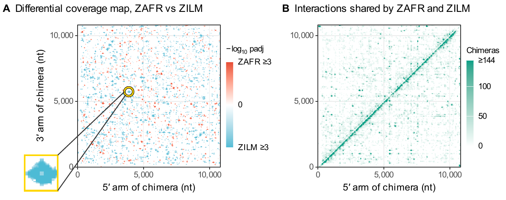

# Hyb2

Hyb2 analyses RNA proximity ligation experiments, such as CLASH, PARIS, SPLASH and COMRADES, which ligate two base-paired RNA segments into one chimeric read. Minimum free energy folding often misses the long-range base pairs that these reads reveal, and the data have lacked integrated analysis tools. From reads or a mapped SAM file, Hyb2:

1. lists the chimeric RNA–RNA interactions, with their coordinates, sequences and folding energies, in a `.hyb` file;
2. plots them as contact density maps and viewpoint graphs, and compares experiments;
3. folds the RNA structures that the chimeras support with its own algorithms, CPLfold and CPLcofold: CPLfold folds one region of an RNA, with its short- and long-range pairs, and CPLcofold two regions of one RNA, two RNAs or a homodimer. For comparison, it also includes two other algorithms that fold structures from chimeras, COMRADES and IRIS ([Structure algorithms](#structure-algorithms)).

<p align="center">
  
</p>

## Contents
- [Choose an entry point](#choose-an-entry-point)
- [Quickstart](#quickstart)
- [Input files](#input-files)
- [`hyb2pipe` options](#hyb2pipe-options)
- [Maps and comparisons on the command line](#maps-and-comparisons-on-the-command-line)
- [Structure algorithms](#structure-algorithms)
- [How to read the outputs](#how-to-read-the-outputs)
- [License](#license)

## Choose an entry point

| Entry point | Use it for | Input | Install |
|---|---|---|---|
| [Web app](https://vicky-0256.github.io/hyb2/) | Exploring `.hyb` files, comparisons and structures (CPLfold and CPLcofold; COMRADES and IRIS for comparison) in the browser; files stay on your computer | `.hyb` | None. To serve your own copy, build it with `make build-web` and serve `web/` ([web/README.md](web/README.md)) |
| Desktop app | One project from raw reads to structures, offline | FASTQ, FASTA, SAM or `.hyb` | Installers for macOS (Apple silicon), Windows and Linux on the [Releases](https://github.com/Vicky-0256/hyb2/releases) page. To build it, see [desktop/README.md](desktop/README.md) |
| `hyb2pipe` (command line) | Reads to `.hyb` on any OS, in scripts or on a cluster. This is the CLI described in the paper | FASTQ, FASTA or SAM, optionally gzipped | Python 3.9+ ([Quickstart](#quickstart)); Bowtie2 for FASTQ/FASTA |
| `hyb2analysis` (command line) | Contact density maps, viewpoint graphs and comparisons of conditions, as tables and SVG files | `.hyb` | Python 3.9+ and NumPy ([below](#maps-and-comparisons-on-the-command-line)) |

The desktop app runs `hyb2pipe` for each sample. On the command line, `hyb2pipe` makes the `.hyb` and the other commands read it:

| Step | Command | Location | Needs |
|---|---|---|---|
| FASTQ/FASTA/SAM to `.hyb` | `python3 -m hyb2pipe` | `pipeline/hyb2pipe/` | Python 3.9+; cutadapt and Bowtie2 for FASTQ/FASTA; ViennaRNA for dG |
| Contact density maps, viewpoint graphs | `python3 -m hyb2analysis coverage`, `viewpoint` | `pipeline/hyb2analysis/` | Python 3.9+, NumPy |
| Differential coverage and similarity | `python3 -m hyb2analysis compare` | `pipeline/hyb2analysis/` | Python 3.9+, NumPy |
| Structures with CPLfold and CPLcofold | `bin/cplfold`, `bin/cplcofold` | `third_party/cplfold/` | Python 3.8+, NumPy, Numba |
| Structures with IRIS, for comparison | `bin/iris` | `pipeline/hyb2analysis/iris.py` | Python 3.11, NumPy, ViennaRNA 2.7.2 |

Until November 2026, `bin/` also held the original shell, Perl, awk and R tools (`hyb2`, `hyb2_coverage`, `hyb2_fold`, `hyb2_app`, `hyb2_compare` and their helpers). The commands above and the two apps replace them; their last version is in [`5398ef3`](https://github.com/Vicky-0256/hyb2/tree/5398ef3/bin).

## Quickstart
This turns the bundled Zika and 18S rRNA test data into `.hyb` files with `hyb2pipe`. It needs Python 3.9 or newer, Git and `make`, but no conda, Perl or R. All commands in this README run in the `hyb2` folder that `git clone` makes:

```bash
git clone https://github.com/Vicky-0256/hyb2.git
cd hyb2
python3 -m venv .venv && . .venv/bin/activate
python -m pip install -r pipeline/requirements.txt
make quickstart
```

`make quickstart` runs `PYTHONPATH=pipeline python3 -m hyb2pipe -i data/testData.sam -d data/Zika_18S.fasta -o out/quickstart -e 1`. It writes 10,411 hybrids, with their folding energies (dG), to `out/quickstart.hyb`, plus `out/quickstart_homodimers.hyb`, `out/quickstart_hybrids.hyb_stats.txt` and the reference with the IDs used in the `.hyb`, `out/quickstart.reference.hyb.fasta` ([Input files](#input-files)). `make help` lists the test and build targets.

On Windows, without `make`, the same in PowerShell or Command Prompt:

```powershell
git clone https://github.com/Vicky-0256/hyb2.git
cd hyb2
python -m venv .venv
.venv\Scripts\python -m pip install .\pipeline
.venv\Scripts\hyb2pipe -i data\testData.sam -d data\Zika_18S.fasta -o out\quickstart -e 1
```

This installs `hyb2pipe` and `hyb2analysis` as commands, so `PYTHONPATH=pipeline python3 -m hyb2analysis` in the examples below becomes `.venv\Scripts\hyb2analysis`.

Then open the `.hyb` and the `.reference.hyb.fasta` in the web or desktop app, or plot them [on the command line](#maps-and-comparisons-on-the-command-line).

## Input files
**Reads: FASTQ or FASTA, optionally gzipped.** Hyb2 trims the 3′ adapter with cutadapt, collapses identical reads into one read named `<rank>_<count>` (later steps take the read count from that name) and maps them with Bowtie2 `-L 10 --score-min L,15,0`, the mapping defaults of the Kudla lab's U2 benchmark (Brr2 CLASH data). FASTA reads that all have such names already are mapped as they are, without trimming. Bowtie2 is not a Python package: install it with conda (bioconda `bowtie2`) or put `bowtie2-align-s` and `bowtie2-build-s` on the `PATH`.

**SAM from another aligner, optionally gzipped.** Read names must end in `_<count>` and must not start with `@`, and reads must be single-end:
- Records with flag 0, 16, 256 or 272 (primary and secondary alignments) are used.
- A paired-end record (flag bit 0x1) stops the run with an error.
- Unmapped records (0x4) are skipped and counted.
- Supplementary alignments (0x800) are skipped with a warning, so have the mapper report chimeric arms as secondary alignments (for example `bwa mem -M`).
- Records with any other flag, such as QC-fail (0x200) or duplicate (0x400), are skipped with a warning and counted separately.

**Reference FASTA (`-d`).** Headers without `|` are used as they are. If any header contains `|`, Hyb2 rewrites every header (`_` becomes `-`, `protein_coding` becomes `mRNA`, and `|` becomes `_`) and drops the records whose header has an empty field (`||`), `unknown` or `pseudogene`. So `>Zika|virusRNA` in `data/Zika_18S.fasta` becomes `Zika_virusRNA`, the gene ID used with `-a` below. An informative ID joins the gene ID, transcript ID, gene name and gene type, for example `>ENSG00000007372.25_ENST00000638963.1_PAX6_mRNA` (see [`data/Zika_18S_formatted.fasta`](data/Zika_18S_formatted.fasta)). `hyb2pipe` leaves the `-d` file unchanged and writes the rewritten reference beside its output, as `<output_prefix>.reference.hyb.fasta`; use that file with the `.hyb`, since its IDs are the ones in the `.hyb`. (The removed `bin/hyb2` wrote the same file next to the input instead, as `data/Zika_18S.hyb.fasta`.)

## `hyb2pipe` options
```bash
PYTHONPATH=pipeline python3 -m hyb2pipe \
    -i <input> -d <reference.fasta> -o <output_prefix> [options]
```

| Option | Meaning | Default |
|---|---|---|
| `-i` | FASTQ, FASTA or SAM, each optionally gzipped | required |
| `-d` | Reference FASTA used for mapping | required |
| `-o` | Output prefix | required |
| `-v` | BLAST threshold | 0.1 |
| `-m` | Maximum overlap | 4 |
| `-h` | Maximum hits per sequence | 10 |
| `-e` | `1` adds the dG column; needs the ViennaRNA Python package, which `pipeline/requirements.txt` installs, or `RNAduplex` on the `PATH` | 0 (off) |
| `--energy-engine` | dG engine with `-e 1`; `rnacofold` gives the legacy `hyb2` values | `rnaduplex` |
| `-p` | Bowtie2 threads and worker processes (positive integer) | all CPUs |
| `--adapter` | 3′ adapter trimmed with cutadapt; `none` skips trimming | `TGGAATTCTCGGGTGCCAAGG` |
| `--min-length` | Minimum read length after trimming (positive integer) | 18 |
| `--seed-length`, `--score-min` | Bowtie2 `-L` (4 to 31) and `--score-min` (legacy `hyb2`: 16 and `L,18,0`) | 10 and `L,15,0` |
| `--bowtie2-args` | Further Bowtie2 arguments, quoted | none |
| `--keep-sam` | Also write `<output_prefix>.sam` (`plain`) or `.sam.gz` (`gz`) | `none` |
| `--memory-mb`, `--tmp-dir`, `--no-resume` | Memory budget in MB (positive integer), work directory and resuming | 1024 and `<output_prefix>.work` |

It writes `<output_prefix>.hyb`, `<output_prefix>_homodimers.hyb` and `<output_prefix>_hybrids.hyb_stats.txt`, and `<output_prefix>.reference.hyb.fasta` when it rewrote the reference's headers. [`pipeline/README.md`](pipeline/README.md) documents every option, memory use and resuming.

## Maps and comparisons on the command line
`python3 -m hyb2analysis` makes the apps' contact density maps, viewpoint graphs and comparisons as tables and SVG files, without R. On the Quickstart output:

```bash
# Contact density map of ZIKV, and of ZIKV (x-axis) with 18S rRNA (y-axis)
PYTHONPATH=pipeline python3 -m hyb2analysis coverage -i out/quickstart.hyb -a Zika_virusRNA -o out/zikv
PYTHONPATH=pipeline python3 -m hyb2analysis coverage -i out/quickstart.hyb -a Zika_virusRNA -b 18S_rRNA -o out/zikv-18s
# Viewpoint graph of ZIKV: the chimera arms that cover each nucleotide
PYTHONPATH=pipeline python3 -m hyb2analysis viewpoint -i out/quickstart.hyb -a Zika_virusRNA -o out/zikv
```

Each command prints the table it wrote (`.contact.txt` cells of 10 nt, or a `.gplot` profile) and writes `contact_map.svg` or `viewpoint.svg` beside it.

`compare` finds the interactions that differ between two conditions, with the desktop app's port of the DESeq2 Wald test, and draws the differential coverage map and the similarity heatmap. It needs both conditions and at least three `.hyb` files:

```bash
PYTHONPATH=pipeline python3 -m hyb2analysis compare --one A1.hyb A2.hyb --two B1.hyb B2.hyb -a Zika_virusRNA -o out/compare
```

With `-i`, it reads the files and their conditions from a table instead, as in [`data/hyb2_compare_input.table`](data/hyb2_compare_input.table). `--help` after a command lists its options, and [`pipeline/README.md`](pipeline/README.md) describes every output.

## Structure algorithms
Hyb2's own structure algorithms are CPLfold and CPLcofold. COMRADES and IRIS, two other algorithms that fold structures from chimeras, are included so that you can compare their structures with Hyb2's, and ViennaRNA's MFE fold of the sequence alone is the control. The table shows what each one folds, and the longest sequence that it folds in each interface:

| Algorithm | Role | Folds | Web app | Desktop app | Command line |
|---|---|---|---|---|---|
| **CPLfold** | Hyb2's own | One region | 500 nt | Limited by memory (Preferences) | `bin/cplfold`, 1,000 nt |
| **CPLcofold** | Hyb2's own | Two regions as two strands: of one RNA, of two RNAs, or two copies of one region (homodimer) | 500 nt in all | Limited by memory (Preferences) | `bin/cplcofold`, 1,000 nt in all |
| COMRADES | Other, for comparison | One region, or two joined by a 100-nt spacer | 2,000 nt; 3,000 if you confirm | 3,000 nt | — |
| IRIS | Other, for comparison | One region | 300 nt | 1,000 nt | `bin/iris`, 1,000 nt |
| ViennaRNA MFE | Control | The sequence alone, without the chimeras | 2,000 nt; 3,000 if you confirm | 30,000 nt | — |

### CPLfold and CPLcofold
CPLfold folds one region with a beam search derived from LinearFold, in which the base pairs that the chimeras support get a bonus, and a second phase can add pseudoknots. CPLcofold folds two strands the same way. Both are the Python package `cplfold` in `third_party/cplfold` (`import cplfold; cplfold.fold(sequence)`, or `pip install third_party/cplfold`) and the local CLIs `bin/cplfold` and `bin/cplcofold`. The core predictor needs NumPy and Numba, not a native HotKnots executable. In the web app, choose the **CPLfold** engine, which folds two regions with CPLcofold; in the desktop app, choose **CPLfold** or **CPLcofold**.

The web app runs CPLfold in your browser without Numba, which limits the sequence length: at most 500 nt, and often less after a speed test in your browser. For a longer sequence, click **Download local inputs** on the structure page, which saves the prepared sequence and, for HYB-guided runs, the bonus matrix that the browser uses. Then run the command shown there, for example:
```bash
bin/cplfold --sequence-file cplfold-input.fasta --bonus-matrix-file cplfold-bonus-matrix.tsv
```
The command shown keeps your settings. `bin/cplfold` refuses sequences over 1,000 nt by default, so for a longer one the command also sets `HYB2_CPLFOLD_MAX_NT` to its length. The [Local CPLfold](https://vicky-0256.github.io/hyb2/local-cplfold.html) page walks through these steps; see [`docs/cplfold-python.md`](docs/cplfold-python.md) for installation, verification and runtime limits, and the [License](#license) for CPLfold's licence terms.

**Binding energies.** The dG column that `hyb2pipe -e 1` writes comes from ViennaRNA's RNAduplex, or from RNAcofold with `--energy-engine rnacofold` (the original `hyb2` values). The apps can recalculate it for each `.hyb` row with CPLcofold, with or without pseudoknots (an experimental score) and for arms of up to 500 nt in all, or with RNAduplex or RNAcofold: **HYB binding energies** in the web app, **Explore › Binding energies** in the desktop app.

### COMRADES and IRIS
**COMRADES.** Here COMRADES is a folding method, not the experiment of the same name. RNAcofold folds the two arms of each chimera together, and the pairs it forms between the arms are the evidence. The 1,001 strongest pairs are merged into stems, and up to 75 stems are added one by one as hard constraints to ViennaRNA MFE folds, in rank order and, if you ask for them, in up to 1,000 seeded random orders; the structure whose pairs have the most evidence wins. This is the method of the original `hyb2_fold`, which ran `comradesMakeConstraints_2` and `comradesFold2` and joined two regions with the same 100-nt spacer ([`5398ef3`](https://github.com/Vicky-0256/hyb2/tree/5398ef3/bin)). COMRADES has no command line now. In the web app, choose the **ViennaRNA** engine and the **COMRADES(ViennaRNA)** folding mode; in the desktop app, choose the **COMRADES** engine, which can also fit the constraints with an mfold 3.6 that you install.

**IRIS** builds a weighted ensemble of one to three structures for one region. It keeps the stems that the chimeras support, folds each stem and each compatible pair of stems as ViennaRNA hard constraints, and picks and weights the structures that best combine low energy and support. `pipeline/hyb2analysis/iris.py` adapts it from [JY-Zhou/IRIS](https://github.com/JY-Zhou/IRIS), whose source is in `third_party/iris/`. With Python 3.11, NumPy and the ViennaRNA Python bindings installed (`python -m pip install numpy ViennaRNA==2.7.2` in an active virtual environment), run:
```sh
bin/iris --reference ref.fa --gene toyRNA --start 31 --end 170 --hyb reads.hyb -o ensemble.json
```
The source CLI and the desktop app use the same Python IRIS predictor, and the CLI runs without the `web/` or `desktop/` trees. See the [IRIS CLI guide](docs/iris-cli.md) for input, output and the files to include in a standalone source archive.

## How to read the outputs
### `.hyb` files
A `.hyb` file has one chimera per row, in 18 tab-separated columns with 1-based coordinates:

| Column | Content |
|---|---|
| 1 | Read ID, ending in `_<count>`: the number of identical reads that it stands for |
| 2 | Read sequence |
| 3 | Binding energy (dG, kcal/mol) with `-e 1`; otherwise `.` |
| 4–9 | First arm: transcript ID, start and end in the read, start and end in the transcript, e-value |
| 10–15 | Second arm: the same |
| 16 | Empty (the annotation column of the original Hyb format) |
| 17 | Overlap of the two arms in the transcript in nt, negative for a gap; `.` when the arms are on different RNAs |
| 18 | Chimera type: `Type_1` to `Type_13` within one RNA (see `add_chimera_types` in [`pipeline/hyb2pipe/finalize.py`](pipeline/hyb2pipe/finalize.py)), or `Intermolecular` |

Tools that split on any whitespace, such as awk, skip the empty column 16 and see 17 columns. `<output_prefix>_homodimers.hyb` holds the rows whose arms overlap by at least 5 nt (column 17): the homodimer candidates.

### Contact density maps
<p align="center">
  <br>
  <sub>ZIKV example data (Fig. 1B of the paper). The profile under the map is the viewpoint graph of the gold region.</sub>
</p>

Each spot counts the chimeras that join two positions, with the positions along the RNA on both axes; when two genes are given, the first is on the x-axis and the second on the y-axis. Chimeras ligated in 5′–3′ and 3′–5′ orientations are plotted above and below the diagonal. Spots near the diagonal are short-range interactions, which fold easily into structures; spots far from it are long-range interactions. Darker spots have more chimeras, and the colour scale is capped at an upper quantile (`hyb2analysis coverage -q`, default 95%).

### Viewpoint graphs
The viewpoint graph is the profile under the contact density map above. For a selected region, it counts the chimeras that join the region to each position of the RNA (x-axis: nucleotide position; y-axis: chimera count), so it shows how often and where along the RNA the region interacts.

### RNA structures
<p align="center">
  
</p>

The structures are coloured by the chimeras that support each base pair: red the most supported, blue the least, and no colour for none. The original `hyb2` drew this image with [VARNA](https://varna.lri.fr/); the drawing editor of the web and desktop apps uses the same colours and can also write a VARNA command for the structure.

### Differential coverage maps and similarity heatmaps
<p align="center">
  <br>
  <sub>Virion libraries of two ZIKV isolates, ZAFR and ZILM, two replicates each (Fig. 5A–B of the paper). The gold circle marks the most significant bin pair, enlarged at the lower left.</sub>
</p>

Read them like contact density maps. A differential coverage map has two colours, red for interactions enriched in one condition and cyan for the other, and the colour shows the significance (adjusted p-value) instead of the count. A similarity heatmap shows the interactions shared by the two conditions.

## License
Hyb2 is free to use for academic and commercial work. No fees are charged for any of its parts.

Hyb2's own code (`bin/`, `pipeline/`, `web/`, `desktop/`, and CPLfold and CPLcofold in `third_party/cplfold/`) is licensed under the GNU General Public License, version 3 or (at your option) any later version (GPL-3.0-or-later). The full text is in [`LICENSE`](LICENSE).

Hyb2 contains and distributes third-party components, each under its own licence: VARNA, IRIS, the LinearFold, LinearCoFold, HotKnots and ViennaRNA parts of CPLfold, D3 and fornac in this repository, and ViennaRNA, Pyodide, NumPy, Numba, cutadapt and Bowtie2 in the website and desktop builds. [`THIRD_PARTY_LICENSES.md`](THIRD_PARTY_LICENSES.md) lists each one, where it is distributed, and its licence.

The CPLfold combination is still being confirmed with the LinearFold authors. CPLfold's GPL part and the LinearFold-derived parser have different terms, and the combination does not yet have one confirmed licence. [`THIRD_PARTY_NOTICES.md`](third_party/cplfold/THIRD_PARTY_NOTICES.md) records the full terms and the original authors. If you publish results from CPLfold, please also cite LinearFold, LinearCoFold, ViennaRNA and HotKnots. If you publish IRIS results, please cite IRIS.
